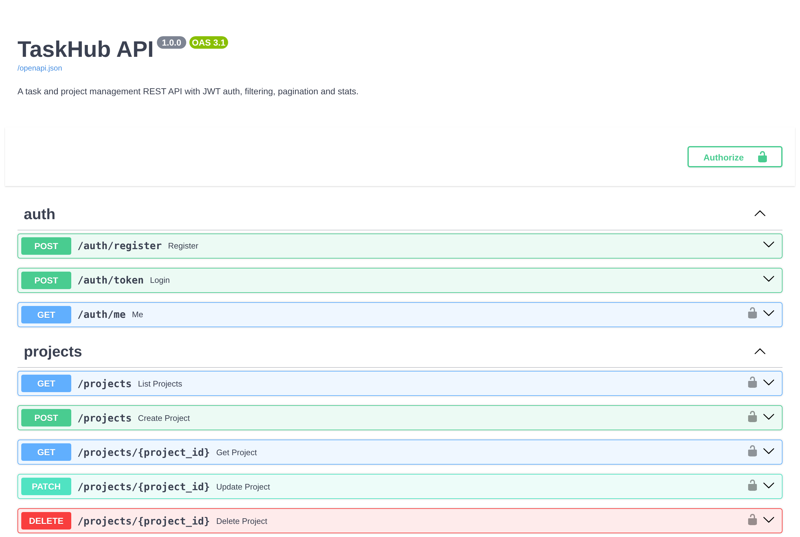

# TaskHub API

**A production-style REST API for projects and tasks, built with FastAPI, PostgreSQL and Docker.** It has JWT auth, per-user data isolation, filtering, search, pagination, project stats, database migrations and a CI pipeline that tests against a real PostgreSQL service.



## Features

- **JWT authentication**: register, log in with the OAuth2 password flow, and use a bearer token. Passwords are hashed with bcrypt.
- **Projects and tasks**: full CRUD, with tasks nested under projects
- **Data isolation**: users only ever see their own data. Another user's project returns `404`, so ids are not leaked.
- **Filtering, search and sorting**: `?status=in_progress&priority=high&q=login&sort=due&order=asc`
- **Pagination**: every list returns `{items, total, limit, offset}`
- **Stats endpoint**: totals by status, overdue count and completion rate, computed in SQL
- **Migrations** with Alembic, applied automatically when the container starts
- **Docker**: multi-stage image that runs as a non-root user, with a health check. `docker compose up` starts the API and PostgreSQL together.
- **CI**: GitHub Actions runs Ruff, checks migrations up and down, runs the tests against PostgreSQL, then builds the image and smoke-tests it

## Quick start

```bash
docker compose up --build
```

Open http://localhost:8000/docs for interactive Swagger docs.

```bash
# Register and get a token
curl -X POST localhost:8000/auth/register -H 'content-type: application/json' \
  -d '{"email":"me@example.com","full_name":"Me","password":"supersecret"}'
TOKEN=$(curl -s -X POST localhost:8000/auth/token -d 'username=me@example.com&password=supersecret' | jq -r .access_token)

# Create a project and a task
curl -X POST localhost:8000/projects -H "Authorization: Bearer $TOKEN" -H 'content-type: application/json' -d '{"name":"Launch"}'
curl -X POST localhost:8000/projects/1/tasks -H "Authorization: Bearer $TOKEN" -H 'content-type: application/json' \
  -d '{"title":"Write README","priority":"high","due_date":"2026-12-01"}'

curl localhost:8000/projects/1/stats -H "Authorization: Bearer $TOKEN"
# {"total":1,"todo":1,"in_progress":0,"done":0,"overdue":0,"completion_rate":0.0}
```

## Endpoints

| Method | Path | Description |
| --- | --- | --- |
| `POST` | `/auth/register` | Create an account |
| `POST` | `/auth/token` | Log in (OAuth2 password form), returns a JWT |
| `GET` | `/auth/me` | Current user |
| `GET` `POST` | `/projects` | List (paginated) or create projects |
| `GET` `PATCH` `DELETE` | `/projects/{id}` | Read, update or delete a project |
| `GET` | `/projects/{id}/stats` | Status counts, overdue tasks, completion rate |
| `GET` `POST` | `/projects/{id}/tasks` | List with filters, or create a task |
| `GET` `PATCH` `DELETE` | `/projects/{id}/tasks/{task_id}` | Read, update or delete a task |
| `GET` | `/health` | Liveness check that also pings the database |

## Run locally without Docker

```bash
python -m venv .venv && source .venv/bin/activate
pip install -r requirements-dev.txt
alembic upgrade head          # uses SQLite by default; set DATABASE_URL for PostgreSQL
uvicorn app.main:app --reload
pytest                        # set TEST_DATABASE_URL to run the suite on PostgreSQL
```

## Project layout

```
app/
  main.py          FastAPI app and routers
  config.py        Settings from environment variables (pydantic-settings)
  database.py      SQLAlchemy 2.0 engine and session
  models.py        User, Project, Task (typed ORM models)
  schemas.py       Pydantic v2 request and response models
  security.py      bcrypt hashing and JWT tokens
  deps.py          Auth and ownership dependencies
  routers/         auth, projects, tasks
alembic/           Database migrations
tests/             pytest suite (runs on SQLite locally, PostgreSQL in CI)
```

## Tech stack

Python 3.13 · FastAPI · SQLAlchemy 2.0 · PostgreSQL 17 · Alembic · Pydantic v2 · PyJWT · Docker · GitHub Actions · pytest · Ruff

## License

MIT
